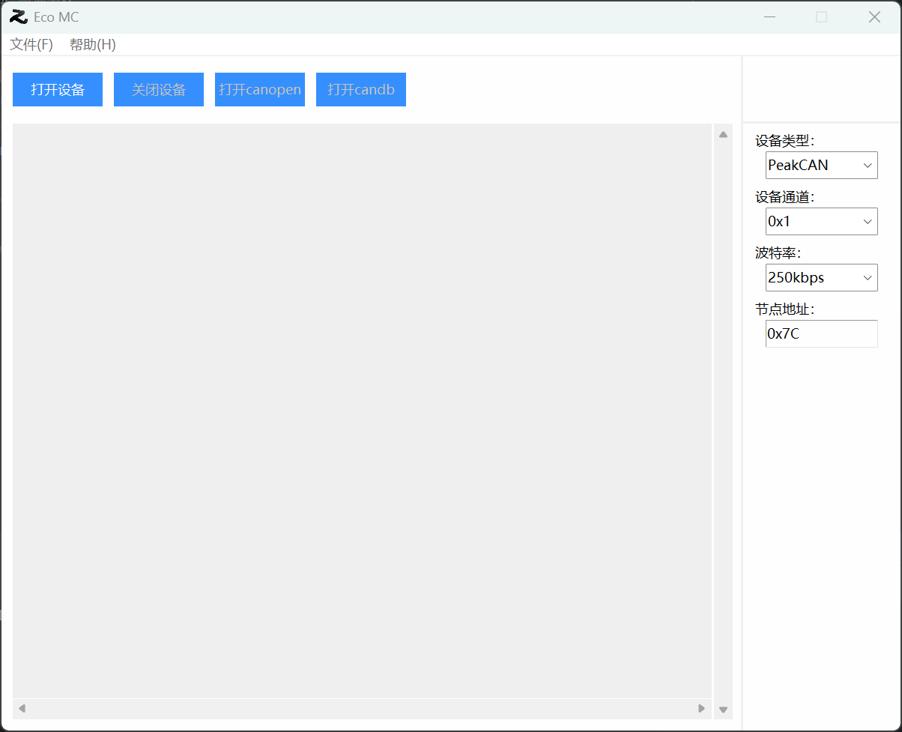

# Eco MC 使用说明

## 产品信息
Eco MC 是一款专为 Windows 系统设计的 CAN 总线监控和标定工具，包含以下两个功能模块：

* **Eco Measure**：用于同时打开多个 DBC 文件并监控对应的 CAN 信号。
* **Eco Calibrate**：用于打开 CANOPEN 文件并通过 SDO 进行标定操作。



---

## 系统要求
- **操作系统**：Windows 10 及以上版本 (x64)
- **Python 版本 (64 位)**：建议使用 Python 3.11.9  
  [Python 解释器下载链接](https://www.python.org/ftp/python/3.11.9/python-3.11.9-amd64.exe)

---

## 外部依赖
1. **安装 PCAN 驱动程序**  
   [PEAK-System_Driver 下载链接](https://peak-system.com.cn/wp-content/uploads/2025/07/PEAK-System_Driver-Setup.zip)

2. **DLL 文件配置**  
   - 将 `docs\LIB\libed.dll` 放置在与 `Eco MC.exe` 同级目录下。
   - 对于 x64 Windows 系统，下载 [PCAN-Basic API](https://peak-system.com.cn/wp-content/uploads/2025/07/PCAN-Basic.zip)：
     - `docs\LIB\PCAN-Basic\x86\PCANBasic.dll` 放置在 `C:\Windows\SysWOW64`
     - `docs\LIB\PCAN-Basic\x64\PCANBasic.dll` 放置在 `C:\Windows\System32`

---

## 打包方式
项目使用 **PyInstaller** 进行打包，打包步骤如下：

1. 安装 PyInstaller 模块：
   ```bash
   pip install pyinstaller
   ```

2. 打包为可执行文件：
   ```bash
   pyinstaller main.py -F -w -i .\icons\Z.ico -n "Eco MC"
   ```

---

## 运行方式
- 以管理员身份运行生成的 `.exe` 文件。

---

## 使用步骤
1. 打开设备。
2. 打开文件（支持 DBC 和 CANOPEN 文件）。
3. 进行监控或标定操作。

---

## 注意事项
* 本产品仅供学习交流使用，**请勿用于商业用途**。